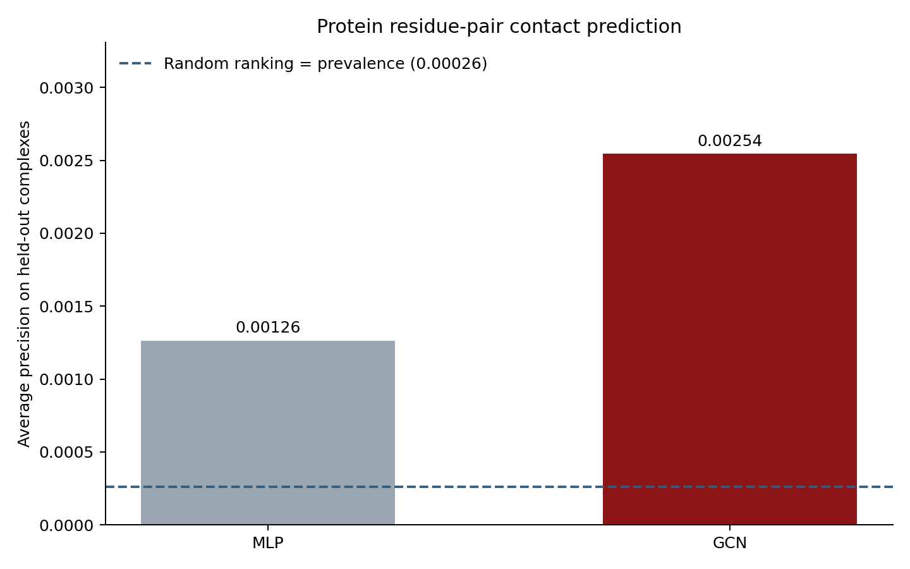

# Protein Interface Prediction with a Graph Convolutional Network

**Solo course project · Graph Neural Networks · 17 October 2026**

## Abstract

Protein interfaces are the sets of amino-acid residues where two proteins touch.
This project predicts which cross-protein residue pairs form contacts. A graph
convolutional network (GCN) encodes the local structure of each protein, and a
small neural network scores residue pairs. We train on 16 protein complexes,
choose model settings on four validation complexes, and evaluate on four held-out
complexes from a public Docking Benchmark 5 mirror. The GCN achieves test
average precision **0.00254**, compared with **0.00126** for a matched MLP
without message passing. Random ranking would have average precision about
**0.000263**, the contact prevalence. These scores show a ranking signal but
also show that accurate pairwise interface prediction remains difficult in
this small, very imbalanced experiment.

## 1. The assigned problem

The attached `GNN_Projects.pdf` lists **Protein Interface Prediction** and
suggests a GCN to learn each protein's residue representation and classify
residue pairs. The task here is:

> Given the 3D structures of partner proteins A and B, assign a score to every
> possible residue pair (i, j). A positive pair has at least one heavy-atom
> distance below 5 Å in an experimentally observed complex.

This is a **link-prediction-like binary classification** problem between two
graphs. It is distinct from predicting a protein's 3D fold, predicting binding
strength, or generating the complete docked orientation.

### Why a graph?

A protein is a chain of amino acids, but distant amino acids in the sequence
can be close in 3D space. A graph connects nearby residues, letting a model
combine sequence identity with the local spatial neighborhood. This follows
the CS224W view of a GNN: represent a system as nodes and edges, perform
message passing, then apply a prediction head to the learned embeddings.

## 2. Dataset and labels

The experiment uses 24 reference complex structures from the public
[LightDock BM5 mirror](https://github.com/lightdock/lightdock_bm5), linked to
the published [Docking Benchmark 5](https://pmc.ncbi.nlm.nih.gov/articles/PMC4677049/).
The fixed list of PDB identifiers is in `protein_gnn.py`, so there is no
search-result drift. The script downloads each reference PDB file and parses
protein chains A and B. Nonstandard residues without a recognized amino-acid
code or a C-alpha atom are omitted.

For residues i in A and j in B, the target is:

`y(i,j) = 1 if min heavy-atom distance(i,j) <= 5 Å; otherwise 0.`

The **5 Å cross-chain distance is used only to make the answer key**. It is not
part of either protein's features or graph. This avoids an immediate answer
leak: given the actual cross-chain distance, the model would simply restate
the label rule.

### Split and prevalence

The first 16 listed complexes form training, the next four validation, and the
last four test. Splitting by whole complex prevents the same pair from
appearing in two sets. The four test complexes contain **797,291 possible
pairs** but only **210 contacts**. Thus the positive prevalence is **0.0263%**.
A classifier predicting “no contact” for every pair would be 99.97% accurate
and completely useless. For this reason, accuracy is not reported as a main
metric.

## 3. Graph construction and features

For each protein separately:

- Node: a residue with a C-alpha coordinate.
- Edge: C-alpha distance at most **10 Å**, or adjacent available residues in
  the protein sequence.
- Node features: 20-dimensional one-hot amino-acid identity, plus normalized
  within-protein graph degree. No cross-protein information is included.

The 10 Å cutoff describes the *within-protein neighborhood*; the 5 Å cutoff
describes the *cross-protein contact label*. They serve different purposes.

## 4. Model: Stanford-style message passing

Let `X` be the residue-feature matrix and `A` the within-protein adjacency
matrix. Add self-loops, then normalize by degree:

`A_norm = D^(-1/2) (A + I) D^(-1/2)`.

The two GCN layers are:

`H1 = ReLU(A_norm X W1 + b1)`

`H2 = ReLU(A_norm H1 W2 + b2)`.

This is the normalized neighbor aggregation of [Kipf and Welling's
GCN](https://arxiv.org/abs/1609.02907), matching the basic message-passing
design taught in [Stanford CS224W's GNN
material](https://web.stanford.edu/class/cs224w/slides/03-GNN1.pdf). Each
layer collects information from immediate graph neighbors; after two layers,
a residue representation can reflect a two-hop neighborhood.

Each protein passes through the **same** encoder. For one candidate pair, the
pair head sees `[h_i, h_j, |h_i-h_j|, h_i*h_j]` and outputs a contact logit.
Hidden width is 32. The baseline replaces both graph-convolution layers with
ordinary linear layers, keeping the same node features and pair head. Thus
the comparison isolates the use of within-protein graph message passing.

Training uses binary cross-entropy and Adam (learning rate 0.003, weight decay
0.0001). Each epoch uses all positive pairs plus up to three randomly sampled
negative pairs per positive. Validation and test score **every possible pair**.
The best epoch is selected by pooled validation average precision among 30
epochs; the decision threshold is selected on validation F1, not test data.

## 5. Results

| Model | Test average precision ↑ | ROC AUC ↑ | Precision ↑ | Recall ↑ | F1 ↑ |
| --- | ---: | ---: | ---: | ---: | ---: |
| MLP, no message passing | 0.001264 | 0.7715 | 0.00229 | 0.0857 | 0.00446 |
| Two-layer GCN | **0.002544** | **0.8463** | **0.00453** | **0.1190** | **0.00873** |

The GCN's average precision is about **2.0 times** the MLP result, and about
**9.7 times** the random-ranking prevalence. This is an association from one
small split; it does not establish that GCNs always outperform MLPs for this
problem. The GCN's best validation AP was 0.00739 at epoch 18, while the MLP's
best validation AP was 0.00971 at epoch 5. The validation ranking was reversed,
which illustrates how unstable this small experiment can be.

The threshold-dependent precision of 0.00453 means fewer than one in 200
predicted positive pairs is correct. Precision at K, where K equals the total
number of actual contacts in test, was **0.0** for the GCN. The MLP's value
was 0.00952. Average precision integrates over the full ranking, so it can
improve even while the very top-ranked subset performs poorly. Both facts
belong in an honest interpretation.

### Per-complex average precision

| Test complex | Contact prevalence | MLP AP | GCN AP |
| --- | ---: | ---: | ---: |
| 3MXW | 0.00101 | 0.0081 | 0.0275 |
| 3EO1 | 0.00053 | 0.0007 | 0.0021 |
| 3AAD | 0.00100 | 0.0023 | 0.0011 |
| 4GXU | 0.00010 | 0.0009 | 0.0019 |

The GCN beats the MLP on three complexes by AP, but loses on 3AAD. Pooled AP
also reflects the especially large, sparse 4GXU example. Full-precision values,
thresholds, and per-complex metrics are saved in `results/metrics.json`.

## 6. Limitations and future work

1. **Small sample.** Twenty-four structures are enough to demonstrate a GNN
   workflow, but not to establish a robust biological predictor. A stronger
   study needs many more complexes and repeated splits.
2. **Possible family overlap.** Whole-complex splitting does not guarantee
   that related protein sequences are separated. A publication-level test
   would cluster by sequence identity before splitting.
3. **Bound structures.** Although the model does not see cross-chain distances,
   each separate chain comes from its *bound* conformation. Performance on
   genuinely unbound inputs is not measured here.
4. **Extreme imbalance.** Sampling negatives makes training feasible but
   changes the training class prior. The output sigmoid is a ranking score,
   not a calibrated probability for all pairs. Calibration and hard-negative
   mining are useful extensions.
5. **Limited features.** Amino-acid identity and local packing omit surface
   accessibility, charge, evolutionary conservation, and richer geometry.
   Those may help, provided each can be computed independently for a partner.

## 7. Conclusion

This project carries out the protein-interface topic with a real dataset, a
GCN, a matched baseline, held-out evaluation, and reproducible code. The GCN
learns some useful ranking signal from within-protein structure, but the very
low precision means it should be presented as a coursework demonstration and
research starting point, not as a reliable drug-discovery system.

## References

1. Course topic handout: user-provided `GNN_Projects.pdf`, “Protein Interface
   Prediction” row.
2. [Stanford CS224W: Machine Learning with Graphs](https://web.stanford.edu/class/cs224w/)
   and [Stanford Online Lecture 7.1: A General Perspective on GNNs](https://www.youtube.com/watch?v=RU9uTa_-ZOw).
3. T. Kipf and M. Welling, [Semi-Supervised Classification with Graph
   Convolutional Networks](https://arxiv.org/abs/1609.02907), 2017.
4. [Docking Benchmark 5 publication](https://pmc.ncbi.nlm.nih.gov/articles/PMC4677049/)
   and [LightDock BM5 data repository](https://github.com/lightdock/lightdock_bm5).
