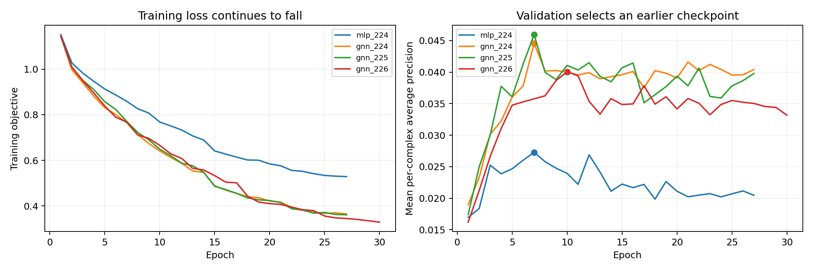
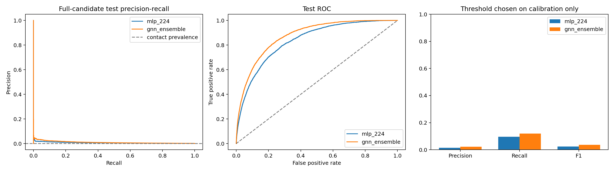

# Protein Interface GNN: Kaggle Experiment

## Research question and completed experiment

Can a shared graph encoder improve prediction of contacting residue pairs over an MLP using the same protein features? We trained the baseline and three GNN seeds directly on Kaggle's two Tesla T4 GPUs. Kaggle confirmed a successful execution in **385.4 seconds** on 21 October 2026. The saved private notebook contains the complete code, method, explanations, logs, and outputs.

This is an educational benchmark study. The GNN improved the within-experiment baseline, but the measured contact precision and F1 are low. These results do not support a claim of reliable biological contact prediction.

## Data and experimental design

The experiment uses the publisher's DB5-Plus release from the DIPS-Plus research project. It contains unbound protein features and residue-pair contact labels. We verified the archive checksum, mapped each positive label to its CA residue, and constructed the full candidate matrix using the publisher's label-construction convention. Stored sampled negatives were not used as an exhaustive evaluation set.

| Partition | Complexes | Purpose |
|---|---:|---|
| Official training | 140 | Learn model parameters and feature preprocessing |
| Checkpoint selection | 18 | Choose epochs using mean per-complex average precision |
| Threshold calibration | 17 | Choose the pooled F1 threshold after training |
| Official test | 55 | Measure final performance using fixed models and thresholds |

The 18/17 partition is a fixed seed-224 split of the 35 official validation complexes. The test contains **5,224,053 candidate pairs**, including **4,891 contacts**: only **0.09362%** are positive. Neither validation nor test negatives were downsampled.

## Model and training method

Each residue is a graph node. Within each unbound protein, edges connect its 20 nearest neighboring residues, with distance radial-basis features and a sequence-gap feature. Cross-partner coordinate distances are excluded because their relative docked pose is not an available input. Median imputation and feature scaling use training proteins only; missing-value indicators are appended, producing 218 node features and 17 edge features.

The shared width-128 encoder has three residual layers. The GNN weights neighbor messages using edge features. The MLP removes neighborhood messages while retaining the encoder width, pair head, input features, and auxiliary loss. It is not an exact parameter-count match. The symmetric contact head combines the sum, absolute difference and product of the partner residue embeddings. A small auxiliary single-residue interface loss supports training; all primary results below refer to **residue-pair contacts**.

Training uses AdamW, learning rate 0.0003, weight decay 0.001, dropout 0.25, gradient clipping at 5, and a validation-based learning-rate schedule. Each epoch resamples ten negatives per positive and balances their loss contribution. The maximum is 150 epochs with early-stopping patience 20. Training logits are not calibrated contact probabilities. We fit each classification threshold on the 17 complete calibration complexes, never on test labels.

| Run | Epochs executed | Selected epoch | Best validation macro AP |
|---|---:|---:|---:|
| MLP, seed 224 | 27 | 7 | 0.02728 |
| GNN, seed 224 | 27 | 7 | 0.04456 |
| GNN, seed 225 | 27 | 7 | 0.04594 |
| GNN, seed 226 | 30 | 10 | 0.04006 |

The run stopped early because validation average precision stopped improving. The saved checkpoints come from the selected epochs, not the last epochs. Running all 150 epochs after that would not establish an improvement. The equal-weight three-GNN logit ensemble was declared before test evaluation.

## Measured test results

Precision, recall and F1 in this table are percentages. ROC-AUC and AP are fractions between zero and one. AP means average precision, not trapezoidal precision-recall area.

| Model | Precision | Recall | F1 | Pooled ROC-AUC | Pooled AP |
|---|---:|---:|---:|---:|---:|
| MLP, seed 224 | 1.39% | 9.59% | 2.43% | 0.8354 | 0.00666 |
| GNN, seed 224 | 1.94% | 10.90% | 3.29% | 0.8646 | 0.00901 |
| GNN, seed 225 | 1.75% | 15.66% | 3.15% | 0.8626 | 0.00963 |
| GNN, seed 226 | 2.05% | 7.89% | 3.25% | 0.8673 | 0.00925 |
| GNN ensemble | 2.16% | 11.94% | 3.66% | 0.8746 | 0.01035 |

The ensemble improves F1 over this experiment's MLP by **1.24 percentage points**. Its median per-complex ROC-AUC is **0.8773** and mean P@10 is **0.05273**, corresponding to 29 true contacts among 550 top-ten proposals across the 55 complexes. Individual seeds are all reported rather than choosing the seed with the highest test result.

## Why the F1 score remains low

At the calibration-selected ensemble threshold, the test confusion counts are:

| Quantity | Count |
|---|---:|
| True positive contacts (TP) | 584 |
| False positive contacts (FP) | 26,409 |
| Missed contacts (FN) | 4,307 |
| Correct negative pairs (TN) | 5,192,753 |

Precision = 584 / (584 + 26,409) = **2.16%**. Recall = 584 / 4,891 = **11.94%**. F1 = 2 x 584 / (2 x 584 + 26,409 + 4,307) = **3.66%**. The model proposed 26,993 contacts, of which 584 were correct. Better overall ranking has not produced reliable contact proposals.

ROC-AUC of 0.8746 means a randomly selected contact usually ranks above a randomly selected non-contact. It does not mean 87.46% contact precision or F1. With more than five million negatives, even a modest false-positive rate produces many false contacts. The ensemble's accuracy is **99.412%**, whereas predicting every pair as non-contact gives **99.906%** accuracy and zero recall/F1. This is why raw accuracy is unsuitable as the headline measure.

The ensemble's MCC is **0.04878** and balanced accuracy is **0.55717**. Its calibration F1 is 7.36%, falling to 3.66% on test. The threshold therefore transfers imperfectly across these complexes. Lowering or raising a cutoff trades precision against recall; tuning it on the test set would invalidate the evaluation.

## Verification and uncertainty

The downloaded archive passed its ZIP integrity check, and its training source exactly matches the locally submitted source. An independent audit recomputed confusion arithmetic, rank-sum ROC-AUC, grouped-threshold average precision, and tie-aware P@10 from all saved predictions. It passed **4,210 checks**, with maximum absolute discrepancy **2.22 x 10^-16**, consistent with floating-point rounding.

The ensemble's pooled F1 has a conditional bootstrap 95% interval of **2.78% to 4.80%**. Resampling uses 52 exact sequence-pair groups because some of the 55 test cases have repeated sequences. This interval conditions on the fitted models and chosen threshold; it does not include all sources of uncertainty or remove homology dependence.

The underlying DB5 test structures were already inspected in earlier project experiments. This is a transparent fixed benchmark rerun, not a new blind external holdout. Exact full pair-sequence matches do not cross official splits, but individual shared partners and related protein families are not excluded. The new DB5-Plus release also differs from the earlier Fout feature release in candidate-pair coverage and a few labels, so changes from the earlier report cannot be attributed solely to a new architecture.

## Defensible conclusion and next research step

The experiment demonstrates graph construction, shared message passing, supervised pair prediction, baseline comparison, validation-based checkpoint selection, threshold fitting, and independent metric verification. Within this fixed experiment, the GNN ensemble improves the baseline. The contact predictions remain too noisy for a strong practical claim.

The next substantive experiment would test pretraining on the much larger DIPS-Plus training data, followed by DB5 fine-tuning and a separately reserved, homology-controlled evaluation. This has not been run here and may or may not improve performance. A universal 0.75 or 0.90 F1 target cannot be promised by increasing training time.

## References and reproducibility

- [Completed Kaggle notebook, version 1](https://www.kaggle.com/code/malleabhinay/protein-interface-gnn-validated-gpu-training?scriptVersionId=360528046)
- [Fout et al., Protein Interface Prediction using Graph Convolutional Networks, NeurIPS 2017](https://papers.neurips.cc/paper/7231-protein-interface-prediction-using-graph-convolutional-networks.pdf)
- [DIPS-Plus / DB5-Plus publisher dataset](https://zenodo.org/records/5134732)
- [Publisher's preprocessing implementation](https://github.com/BioinfoMachineLearning/DIPS-Plus/blob/main/project/utils/training_utils.py)

Local reproducibility files include the self-contained notebook, source, frozen split manifest, four checkpoints and epoch histories, five sets of test predictions, metric summaries and independent audit. The original downloaded Kaggle results archive is preserved unchanged.
