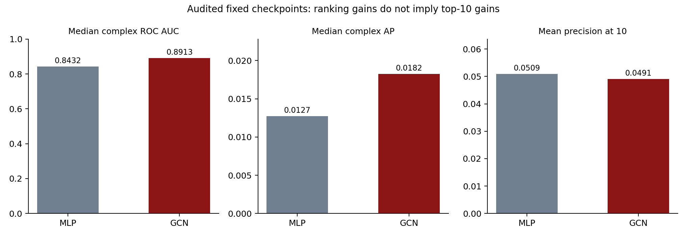

# Protein Interface Prediction with a Graph Neural Network

This **solo course project** follows the protein-interface topic in the
provided assignment and the directly relevant [Fout et al. NeurIPS 2017
paper](https://papers.neurips.cc/paper/7231-protein-interface-prediction-using-graph-convolutional-networks.pdf).
It implements a two-layer node-average GCN in PyTorch and compares it with
a matched no-convolution MLP on the authors' released Docking Benchmark 5
features and residue-pair labels.

## Start here

- [Kaggle GPU experiment](kaggle_training/README.md): new cloud training on
  DB5-Plus with three GNN seeds, full-pair validation, and calibrated
  classification thresholds. Completed and audited: ensemble F1 3.66%,
  baseline F1 2.43%; see [the Kaggle results explanation](KAGGLE_RESULTS.md).
  The measured results below describe the earlier audited benchmark.
- [Beginner guide](BEGINNER_GUIDE.md): the biology and GNN concepts in
  plain language.
- [Full report](REPORT.md): method, measured results, paper comparison,
  limitations, and references.
- [Research and GitHub links](RESEARCH.md): original code, dataset, and
  modern related work.
- [Metric audit](METRIC_AUDIT.md): independent recomputation, retrieval
  results, confusion counts and score-calibration diagnostics.
- [Metric explanation guide](METRICS_GUIDE.md): why each measure is used,
  formulas, examples and answers for the viva.
- [Presentation notes](PRESENTATION.md): slide-by-slide explanation and
  likely viva questions.
- [Submission guide](SUBMISSION.md): which finished files to hand in.

## Measured result

On the authors' 55-complex official test set, the two-layer GCN achieved
**0.8913 median per-complex ROC AUC**, versus **0.8432** for the MLP. It
had higher AUC on **42 of 55** complexes. Median per-complex average
precision was **0.0182** versus **0.0127**. Contacts are only **0.0982%**
of the released test pair labels, so these scores need careful interpretation.
This is one fixed PyTorch run; it is not an exact reproduction of the paper's
ten-run TensorFlow experiment.

The audit reproduced the original AUC and AP values exactly. It also found
that **top-10 precision is lower for the GCN: 4.91% versus 5.09%** (27 versus
28 contacts among 550 recommendations). The raw 0.5 score cutoff produces
many false positives, and the scores are uncalibrated. Thus this run supports
an overall ranking gain, not a general improvement in early contact retrieval.



## Reproduce the main experiment

Use Python 3.10+ from this folder:

```powershell
python -m pip install -r requirements.txt
python paper_benchmark/download.py
python paper_benchmark/benchmark.py --epochs 35 --patience 7
python paper_benchmark/analyze.py
python paper_benchmark/verify.py
python paper_benchmark/test_evaluation.py
python paper_benchmark/audit_metrics.py
```

The download is about 98 MB and is MD5-verified. The CPU training and test
evaluation take several minutes. Complete metrics, 55 per-complex results,
model weights, and the figure are in `paper_benchmark/results`.
The audit stores pair-level predictions and full per-complex metrics. It can
be run directly on the included checkpoints without retraining them.

## Build submission files

```powershell
python make_submission.py
python package_submission.py
```

The first command creates a report PDF and editable presentation in
`submission`. The second creates the complete project ZIP in the parent
Documents folder. Report and slide generation require `reportlab` and
`python-pptx`, both listed in `requirements.txt`.

## Files and provenance

| Path | Purpose |
| --- | --- |
| `paper_benchmark/benchmark.py` | Main model training and official test evaluation |
| `paper_benchmark/dataset.py` | Restricted loader for the authors' Python 2 data files |
| `paper_benchmark/download.py` | Official data download with published MD5 checks |
| `paper_benchmark/analyze.py` | Paired bootstrap, prior-exposure subset, figure |
| `paper_benchmark/verify.py` | Split and model-invariance checks |
| `paper_benchmark/evaluation.py` | Explicit metric definitions and tie handling |
| `paper_benchmark/test_evaluation.py` | Hand-calculated and independent metric checks |
| `paper_benchmark/audit_metrics.py` | Saved-checkpoint audit, full diagnostics and prediction cache |
| `paper_benchmark/results/metric_audit.json` | Full audited metrics and provenance |
| `paper_benchmark/results/audited_per_complex.csv` | Inspectable per-model, per-complex measures |
| `paper_benchmark/results/benchmark_metrics.json` | Full measured results |
| `references/Fout_et_al_2017_Protein_Interface_GCN.pdf` | Main research paper |
| `assignment/GNN_Projects.pdf` | The supplied topic handout |

The earlier `protein_gnn.py` and `results/` folder are an **exploratory
24-complex bound-structure experiment**. Their different 5 Å contact rule
and sample prevent direct comparison with the primary benchmark. The old
report, plan, guide, and presentation are kept as `EXPLORATORY_*.md` for
provenance. Present the new `REPORT.md` and `paper_benchmark` results.
