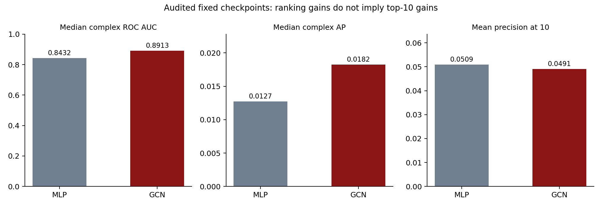
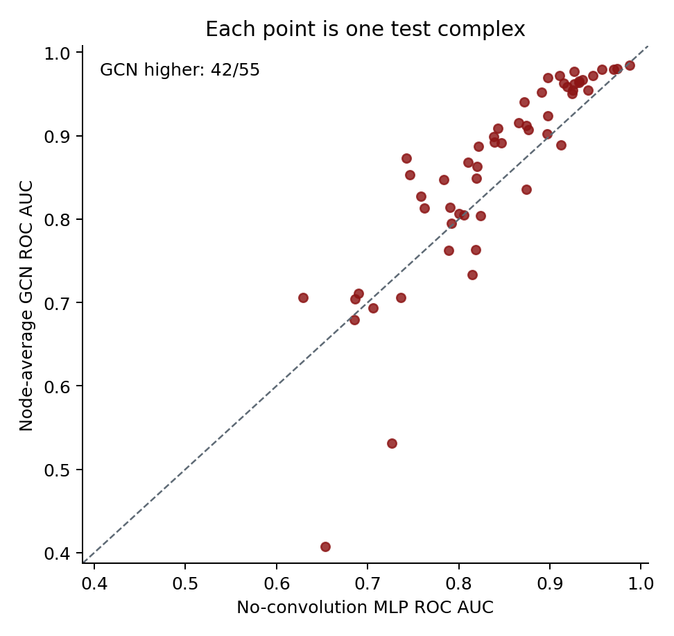

# Protein Interface Prediction with Graph Convolutional Networks

**A paper-guided PyTorch reimplementation · Solo GNN course project · 20 October 2026**

## Abstract

Protein interface prediction asks which pairs of amino-acid residues on two
proteins will touch when they bind. This project reimplements the main
node-average graph convolution idea of Fout et al. (NeurIPS 2017) in modern
PyTorch and evaluates it using the authors' released Docking Benchmark 5
features and labels. Two shared graph encoders learn residue representations;
a symmetric neural classifier scores cross-protein pairs. The official test
contains 55 complexes, 4,958,317 labeled pairs, and 4,871 contacts. A
two-layer node-average GCN reaches **0.891 median per-complex ROC AUC** versus
**0.843** for a feature/head-width matched no-convolution MLP. The GCN has
higher ROC AUC on **42 of 55** test complexes. Median per-complex average precision improves
from **0.0127** to **0.0182**. These are measured results from one fixed run,
not a claim of clinical or drug-discovery readiness or an exact reproduction
of the paper's ten-run experiment.

An independent metric audit reproduces the saved results exactly, but reveals
that mean precision at ten recommendations per complex is **4.91% for the
GCN versus 5.09% for the MLP**. The evidence supports improved overall
ranking, not a uniform improvement in the most useful contacts retrieved.

## 1. Problem and research question

The assigned topic in `GNN_Projects.pdf` is **Protein Interface Prediction**.
Each protein is represented as a graph of amino-acid residues. Given two
separate protein structures, the model predicts whether a selected ligand
residue and receptor residue form an interface contact. The central research
question is:

> Does passing information between spatially neighboring residues improve
> pairwise contact ranking compared with a model using each residue's own
> features only?

This is a residue-pair classification task. It is not protein folding, binding
affinity prediction, or docking-orientation generation. The user-provided
topic description closely follows [Fout et al., Protein Interface Prediction
using Graph Convolutional Networks](https://papers.neurips.cc/paper/7231-protein-interface-prediction-using-graph-convolutional-networks.pdf).
The local copy is `references/Fout_et_al_2017_Protein_Interface_GCN.pdf`.

## 2. Relevant literature and implementation choices

Fout et al. use two weight-sharing graph-convolution branches, one for each
protein, followed by a residue-pair classifier. Their Equation (1) keeps a
separate learned transform for the center residue and the average of its
neighbors. This project implements that operator. The [authors' original
code](https://github.com/fouticus/pipgcn) uses Python 2.7 and TensorFlow
1.0.1; our code is a new, compact PyTorch implementation. We did not copy
their model weights or claim to reproduce their exact architecture.

Modern related work includes [DeepInteract](https://github.com/BioinfoMachineLearning/DeepInteract),
which uses geometric transformers, and [DIPS-Plus](https://github.com/BioinfoMachineLearning/DIPS-Plus),
a larger dataset with richer protein features. Their data and computational
requirements are much greater than this solo CPU experiment. `RESEARCH.md`
links the papers, repositories, and exact differences.

## 3. Dataset and leakage control

We use the [authors' Zenodo data record](https://zenodo.org/records/1127774).
The two compressed files were downloaded and checked against the authors'
published MD5 hashes. `train.cpkl.gz` has **175 development complexes** and
`test.cpkl.gz` has **55 official test complexes**. The PDB identifiers in
these groups do not overlap. The files provide, for each partner, a 70-feature
vector for every residue and indices of its 20 spatially nearest neighbors.
They also provide labeled ligand–receptor residue pairs.

The paper computes residue features from the **unbound** protein structures.
Its contact labels come from the **bound** complex: two residues are positive
if any non-hydrogen atom pair is within **6 Å**. This is a substantially
better-defined challenge than using both input graphs from bound structures.
The model sees the separate-protein features and neighbor indices, but it is
never given the bound cross-protein distance or contact label as an input.

The released development labels were already downsampled to approximately
**10 negatives per positive**. We train on those provided pairs. The released
test labels include all authors' evaluable pairs, not just the downsampled
development negatives: **4,958,317 labeled pairs** with **4,871 contacts**,
or **0.0982% positives**. **266,605** Cartesian-product pairs are absent from
the authors' test file; our evaluation scores exactly the pairs they released
and does not silently label the omitted pairs as negatives.

### Split and model selection

The paper's original 140/35 train/validation split was stratified by complex
type and difficulty, but the released training file groups the 175 cases
together without an explicit split. We use a **fixed seeded 140/35 split**
(`seed = 224`). The best epoch for each model is chosen by **median validation
ROC AUC**, then that model is freshly initialized and trained for that number
of epochs on all 175 development complexes. Only then is the official test
set scored. Validation average precision is not treated as comparable to
test average precision because validation negatives were downsampled.

## 4. Graph model

For residue i, let `x_i` be its 70-dimensional feature vector and `N(i)` the
20 nearest residues in the same protein. One graph-convolution layer is:

`h_i(next) = ReLU(W_center h_i + W_neighbor mean_{j in N(i)} h_j + b)`.

This is Fout et al.'s node-average idea: the central residue and its neighbors
can have different learned effects. Two such layers with **64 hidden units**
encode the ligand and receptor, using the **same encoder weights** for both.
The two-layer receptive field incorporates neighboring context beyond the
single residue. We use dropout 0.2. No edge-feature branch is used, so this
is a node-average model rather than the paper's node-and-edge variant.

For ligand embedding `u` and receptor embedding `v`, the pair classifier
receives `[u+v, |u-v|, u*v]`. This combination is invariant to swapping the
two protein partners. A dense layer returns a contact logit. We train with
weighted binary cross entropy (positive weight 10), Adam (learning rate
0.001, weight decay 0.0001), and gradient clipping at 5. The model is small
enough to run on a CPU.

### Matched baseline

The no-convolution MLP uses the **same 70 features**, two 64-unit layers,
dropout, pair representation, loss, optimizer, development split, and test
scoring code. Its layers transform only the center residue: they do not read
the nearest-neighbor indices. Thus the key tested difference is graph
message passing. It is our feature/head-width matched baseline, not the paper's
original no-convolution implementation. It is not parameter matched: the MLP
has **21,121** trainable parameters and the GCN **29,697**. Added capacity is
therefore a possible contributor to the result, alongside graph context.

## 5. Evaluation measures

**ROC AUC** asks whether a randomly chosen contact receives a higher score
than a randomly chosen noncontact. To match the paper's principal reporting
style, we compute AUC separately for every test complex and report the
**median across 55 complexes**. This prevents a very large complex from
dominating the headline number.

**Average precision (AP)** summarizes precision over the ranked predictions
and is especially informative for rare contacts. We report the median
per-complex AP and the pooled AP. The latter ranks all released test pairs
together, so it answers a different question and can be dominated by large
complexes. The test prevalence, 0.000982, is a conventional pooled random-ranking
AP reference. AP and the **trapezoidal PR area** are different numerical
conventions; the audit computes them separately and does not interchange them.

**Top-K precision and recall** measure a limited inspection budget per complex.
We use K=10, 50, L/5 and L, with `L=min(number of ligand residues, number of
receptor residues)` and `L/5=max(1,floor(L/5))`. These are explicitly defined
project budgets. Precision is contacts found divided by K; recall is contacts
found divided by all known contacts. A tie crossing the cutoff receives its
expected credit under uniform tie breaking, avoiding dependence on input row
order. **Standardized partial ROC AUC at FPR <=1%** tests ranking under a
small false-positive-rate budget; its chance reference is 0.5.

Confusion counts, precision, recall, F1, MCC, specificity and balanced accuracy
are recorded at a fixed sigmoid threshold of 0.5 **as diagnostics**. This is
not a validated operating point. Negative downsampling and positive loss
weighting change the training prior, so raw sigmoid outputs cannot be treated
as calibrated contact probabilities. No test-optimal threshold is selected.
`METRICS_GUIDE.md` explains each measure, and `METRIC_AUDIT.md` gives the
full numerical checks and rationale. The additional audit measures are
post-hoc diagnostics of frozen models rather than confirmatory endpoints.

## 6. Measured results

| Model | Median ROC AUC | Mean ROC AUC | Median AP | Pooled AP |
| --- | ---: | ---: | ---: | ---: |
| No-convolution MLP | 0.8432 | 0.8411 | 0.0127 | 0.00835 |
| Two-layer node-average GCN | **0.8913** | **0.8605** | **0.0182** | **0.00928** |

| Model | Mean precision at 10 | Mean recall at 10 | Mean precision at L/5 | Mean precision at L |
| --- | ---: | ---: | ---: | ---: |
| No-convolution MLP | **0.05091** | **0.00679** | 0.04482 | 0.03372 |
| Two-layer node-average GCN | 0.04909 | 0.00658 | **0.05052** | **0.03676** |

These retrieval results limit the interpretation. The GCN finds **27 contacts
among 550 top-10 recommendations**, versus **28** for the MLP. Its top ten
contains no contact on **39/55** complexes (MLP: **36/55**). The paired
95% complex-bootstrap interval for the mean precision-at-10 difference is
**[-0.0273, 0.0218]**; for mean precision at L/5 it is
**[-0.0107, 0.0217]**. Both include zero. Standardized pooled partial ROC AUC
at FPR <=1% is **0.54159** for the GCN and **0.54215** for the MLP. Thus
the overall AUC advantage does not establish superior early contact retrieval.

The difference in the two models' median complex AUC is **0.0481**. Across
the same 55 complexes, the GCN has higher AUC on **42**, and the MLP on 13.
A paired complex bootstrap gives an exploratory 95% interval of
**[0.0148, 0.0655]** for the difference of medians. This interval samples
complexes; it does not include variation from retraining with different
random seeds, and homologous complexes may not be independent.

The validation-selected epoch is **23** for the MLP (best median validation
AUC **0.8253**) and **27** for the GCN (best **0.8836**). Full training
histories, split IDs, and per-complex test results are in
`paper_benchmark/results/benchmark_metrics.json`.

### Important prior-exposure check

The earlier exploratory version of this project evaluated 24 complexes from
the paper's 55-complex test group. Therefore the complete official test set
is **not entirely untouched in this project's history**. On the other **31
test complexes not used in the initial bound-structure exploration**, the GCN median AUC is **0.8529**
versus **0.8186** for the MLP; it wins on **21 of 31**. The paired bootstrap
interval for this subset is **[-0.0198, 0.0658]**, which includes zero.
This subset check is a disclosure analysis, not a substitute for a prospectively
designed new benchmark. Its exact IDs and calculations are in
`paper_benchmark/results/analysis.json`.

This 31-case subset has now also been examined. It is a fixed historical
subset, not a new blind holdout.

### Relation to published results

Fout et al. report **0.882 ± 0.007** median test AUC for their two-layer
node-average method and approximately **0.810 ± 0.006** for their two-layer
no-convolution method, averaging ten independent runs. Their best two-layer
node-and-edge method reports **0.898 ± 0.005**. Our single-run **0.8913**
node-average result is in the same range, but the numbers are **not a direct
replication**: architecture width, classifier, optimization, validation
split, random-run count, and use of edge features differ. We do not claim a
state-of-the-art comparison from this experiment.

## 7. Interpretation and limitations

The model using within-protein neighborhoods has higher overall ranking
scores in this experiment.
The difference is biologically plausible: a residue's potential interface
role depends on its surrounding surface patch, not only its own features.
Yet ROC AUC near 0.89 does **not** mean 89% of predicted contacts are correct.
Contacts comprise less than 0.1% of evaluable pairs, so even useful ranking
still yields modest precision. Pooled AP is **0.00928**; this is a ranking
summary, not the precision of a selected prediction list. The GCN is weaker
on top-10 precision than the MLP in this run.

At the diagnostic raw threshold 0.5, the GCN predicts **478,018** contacts:
**2,702** are true positives and **475,316** are false positives. It misses
**2,169** contacts. Precision is **0.00565**, recall **0.5547**, F1
**0.01119**, and MCC **0.04869**. An always-negative classifier has
**99.9018% accuracy** yet zero recall, F1 and MCC, illustrating why plain
accuracy would be misleading. Raw GCN mean sigmoid score is **0.1276**,
far above the observed contact prevalence **0.000982**. Calibration and
a useful threshold remain unvalidated.

The main limitations are one training seed, a fixed but unstratified
development split, prior exposure to part of the official test group, and
possible similarity between protein families. The 70 input features are
precomputed by the data authors; this code cannot infer them directly from
an arbitrary new PDB file. The dataset uses experimentally known partners
and does not address whether two arbitrary proteins bind or what their docked
orientation is. No single test score should be described as “perfect.”

The metric audit checks numerical evaluation and data provenance. The contact
definition and bound/unbound residue mapping are inherited from the published
data, rather than independently rebuilt from structures. No exact identical
feature-and-neighborhood chain representations were found across development
and test; this does not establish sequence-family independence.

## 8. Reproducibility and conclusion

Run `python paper_benchmark/download.py` followed by
`python paper_benchmark/benchmark.py --epochs 35 --patience 7`, then
`python paper_benchmark/analyze.py` and `python paper_benchmark/verify.py`.
The downloader checks the published MD5 hashes; the benchmark records its
seed, split IDs, selected epochs, every test complex's metrics, and saved
PyTorch weights. Verification confirms that train and test IDs are disjoint,
pair scoring is invariant to swapping partners, and the GNN is equivariant
to relabeling residues.

Run `python paper_benchmark/test_evaluation.py` and
`python paper_benchmark/audit_metrics.py` for the metric audit. Both saved
checkpoints were rescored; every original per-complex AUC, AP and legacy
top-L score reproduced exactly. Independent rank-sum AUC and threshold-group
AP formulas agree with scikit-learn to **3.33e-16**, including tied scores.
Cached pair-level logits, sigmoid scores, labels, indices, dataset/model
hashes, and `audited_per_complex.csv` make each number inspectable.

The project demonstrates the graph-neural-network workflow taught in
[Stanford CS224W](https://web.stanford.edu/class/cs224w/): define graphs and
features, aggregate neighborhood messages, make pair predictions, then
evaluate on held-out graphs. On the authors' official DB5 labels, this
lightweight GCN improves overall contact ranking over the center-only model,
while failing to improve top-10 retrieval. This distinction, the single seed,
the capacity difference and the test-exposure history constrain the conclusion.

## References

1. Fout, Byrd, Shariat, and Ben-Hur. [Protein Interface Prediction using
   Graph Convolutional Networks](https://papers.neurips.cc/paper/7231-protein-interface-prediction-using-graph-convolutional-networks.pdf).
   NeurIPS, 2017. [Original code](https://github.com/fouticus/pipgcn),
   [released dataset](https://zenodo.org/records/1127774).
2. Morehead, Chen, and Cheng. [Geometric Transformers for Protein Interface
   Contact Prediction](https://arxiv.org/abs/2110.02423). ICLR, 2022.
3. Morehead et al. [DIPS-Plus: The enhanced database of interacting protein
   structures for interface prediction](https://www.nature.com/articles/s41597-023-02409-3).
   Scientific Data, 2023.
4. Stanford University. [CS224W: Machine Learning with Graphs](https://web.stanford.edu/class/cs224w/)
   and [Graph Neural Networks slides](https://web.stanford.edu/class/cs224w/slides/03-GNN1.pdf).
# Latest experiment note

The follow-up Kaggle GPU experiment is documented in `KAGGLE_RESULTS.md`
and `submission/Kaggle_Experiment_Report.pdf`. It uses the DB5-Plus release,
three GNN seeds and separate threshold calibration. Its ensemble achieved
3.66% F1 versus 2.43% for its baseline. The earlier benchmark below uses
different candidate-pair coverage and retains its original audited scores.

